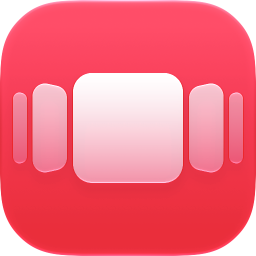

# VibePod
Native music player for your own songs, on iPhone, iPad and Mac. Everything Apple Music keeps for its catalog, on your local files, plus a lot more.
Local, no account, no ads.

## Apple Music features, on your own songs
- Word-by-word synced lyrics, duets included, found automatically (or transcribed by AI when none exist)
- Sing: lower the vocals and sing along
- AutoMix transitions between songs
- Animated covers
- Music videos, synced with your file, with their own full-screen player
- Music Haptics
- Lyrics translation
- Lyrics sharing as an image or an animated video
- Listening stats, Replay-style, and a yearly Wrapped

## And more
- **Assistant**: ask by text or voice to play something, build a playlist, set a sleep timer or explain a song
- **Autolists**: smart playlists, with more rules than Apple Music (period, genres, decades, mood, tempo, workouts, refresh rate…)
- **Programs**: listening moments built from steps, like a shortcut (“4 times this song, then 3 random songs from that album…”)
- **iCloud sync** of lyrics, playlists, stats and settings between your devices
- **Music servers**: stream from Navidrome or any (Open)Subsonic server, and download songs
- **Listening history import** from Spotify, Apple Music, Deezer, YouTube Music, Last.fm or ListenBrainz, matched to your library
- **Customizable UI**: accent color or Infused (follows the playing cover), your own shortcuts, Liquid Glass everywhere
- Smooth, native app, 100% Swift
- **Extras**:
  - AirPods gestures (nod, shake, tilt)
  - Song merge, with a waveform editor
  - Discord status
  - Apple Health workouts in Stats and Autolists
- Games played with your library: What Comes Next?, What Song Is That?, Who Sings This?, Music Tiles, Covers Snake
- Spotify playlist import, song transfer between your devices, equalizer, widgets, Siri and Shortcuts
- French and English

## Requirements
- iOS 26+ (iPhone and iPad), macOS 26+ (Mac Catalyst)
- Optional API keys, stored in the Keychain:
  - Mistral, for the assistant and AI lyrics
  - Groq or Speechmatics, as other AI lyrics engines
  - YouTube Data API, for music videos

## Install
Join the beta on [TestFlight](https://testflight.apple.com/join/V6ZZX137).

Or grab the .ipa from [Releases](https://github.com/tlfares/VibePod/releases) and sideload it (AltStore, SideStore, Sideloadly…). You can also build it from source with Xcode.

The Discord SDK isn't in the repo, because Discord owns its license. To build with it:
1. Download it from the [Discord Developer Portal](https://discord.com/developers/docs/discord-social-sdk/getting-started).
2. Put `discord_partner_sdk.xcframework` in `Frameworks/`.

## Disclaimer
VibePod is not affiliated with Apple, YouTube, Spotify, Mistral, Groq, Speechmatics or Discord.
